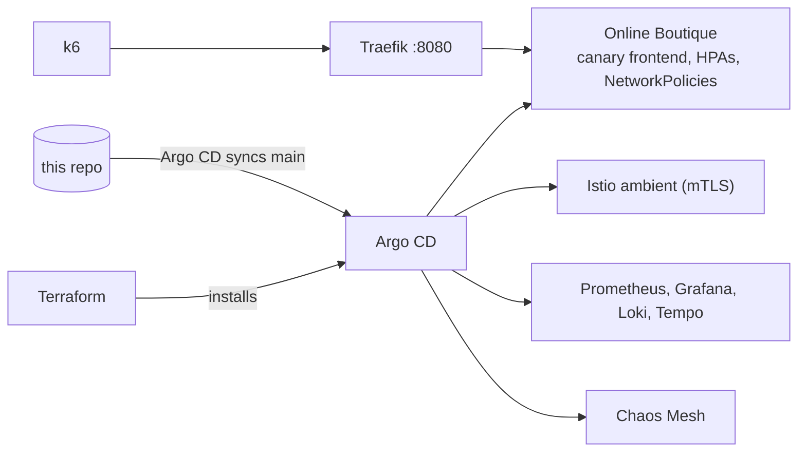

# Sentinel

A GitOps Kubernetes platform that runs Google's [Online Boutique](https://github.com/GoogleCloudPlatform/microservices-demo) (11 microservices) on a local k3d cluster, with canary releases, a service mesh, observability, SLO alerts and chaos experiments. Everything is defined in this repository and rebuilt with one command.

A **portfolio project**, built and measured on one laptop.

## How it works



- **Terraform** installs Argo CD; **Argo CD** installs everything else from `gitops/`. A push to `main` deploys.
- **Argo Rollouts** ships the frontend as a canary and rolls back automatically if Prometheus shows errors or slow responses.
- **Istio ambient** gives every service mTLS without sidecars; **Prometheus, Grafana, Loki, Tempo** cover metrics, logs and traces; SLO alerts go to Alertmanager.
- **CI** (GitHub Actions) lints, validates, scans for secrets and smoke-tests the app in kind on every push.

## Setup

Needs Docker (8 CPUs, 10 GB memory), `make`, [k3d](https://k3d.io) 5.9, kubectl and Terraform 1.17; [k6](https://k6.io) for load tests. Tested on an Apple Silicon Mac. Run `docker login` first to avoid Docker Hub pull limits.

```bash
git clone https://github.com/harshakallem22/sentinel.git && cd sentinel
make up        # cluster, images, Argo CD; Argo CD installs the rest
make status    # wait until all Argo CD apps are Synced/Healthy
```

| What | How |
|---|---|
| Shop | http://localhost:8080 |
| Grafana | `make grafana-ui` → http://localhost:3000 (password: `make grafana-admin`) |
| Argo CD | `make argocd-ui` → http://localhost:8081 (user `admin`, password: `make argocd-admin`) |
| Test an order | `scripts/checkout-smoke.sh` |
| Load test | `loadtest/run-suite.sh smoke` |
| Chaos test | `kubectl apply -f chaos/experiments/currencyservice-latency.yaml` |
| Stop / delete | `make down` / `make destroy` |

The first `make up` builds the 11 app images from source and takes longer; after that a full rebuild takes about 5 minutes.

## Results

Measured on one k3d node on an M3 MacBook (16 GB), k6 at ~15 req/s unless stated.

| What | Result |
|---|---|
| Full rebuild from Git to a working checkout | **~5 min** (median of 3) |
| Bad canary → automatic rollback | **59 s** (3/3 trials) |
| Baseline latency | P95 **68 ms**, 0% errors |
| Mesh overhead | **+0.9 ms** P50 |
| Traffic spike, autoscaling | P95 **402 → 139 ms** once new pods were Ready (41 s), 0% errors |
| Backend pod killed | users saw errors for **27 s**, then self-healed |
| SLO alerts | each one fired and resolved on its own in fault tests |

## Limitations

- Single node on a laptop: numbers show relative effects, not production capacity.
- One replica per service (as upstream ships it), so one failed backend can take pages down.
- The IAM least-privilege role was only run against LocalStack, which does not enforce IAM.
- Images are built for arm64; only tested on Apple Silicon.

## Attribution

[Online Boutique](https://github.com/GoogleCloudPlatform/microservices-demo) is developed by Google and licensed under the [Apache License 2.0](https://github.com/GoogleCloudPlatform/microservices-demo/blob/v0.10.7/LICENSE). It is deployed here unmodified: `gitops/boutique/upstream/kubernetes-manifests.yaml` is Google's v0.10.7 manifest, and `scripts/build-boutique-images.sh` builds the images from the unmodified v0.10.7 source.
